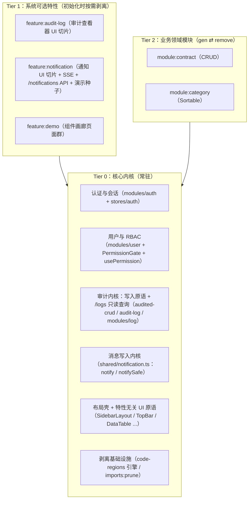
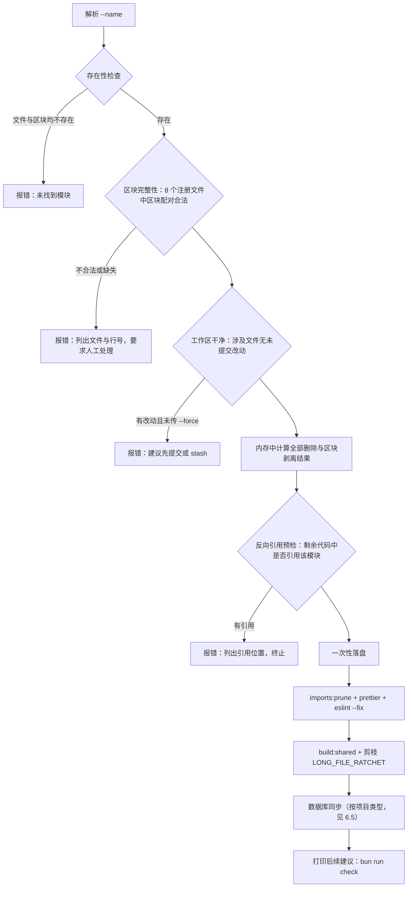

# 模块化与可插拔架构详细设计（Modular & Pluggable Architecture）

> **文档状态**：Revised v2 — Ready for Implementation  
> **适用范围**：`liquid-glass-starter` 模板仓库、脚手架（`tools/scaffolder/scripts/scaffold.ts`）、业务模块生成器（`scripts/gen-module.ts`）  
> **核心目标**：在 **保持静态类型推导、Tree-shaking 与 AST 架构门禁** 的前提下，实现「系统可选特性（审计查看器 / 消息中心 / 演示）初始化一键干净剥离」与「业务领域模块 `gen:module` ⇄ `remove:module` 对称增删」。

---

## 0. 修订记录与关键决策

### 0.1 v2 相对 v1 的变化

| #   | 变化                                                                                                                 | 动机                                                                                                                         |
| :-- | :------------------------------------------------------------------------------------------------------------------- | :--------------------------------------------------------------------------------------------------------------------------- |
| 1   | 新增 **§3 统一机制：代码区块标记 + 未用导入剪枝**，Tier 1 与 Tier 2 共用一套剥离引擎                                 | v1 诊断了「脆弱正则」却没给出替代方案；8 个 `unregister*` 启发式函数（括号配对、回溯 JSDoc、引用计数）复杂且对手改代码不鲁棒 |
| 2   | 剥离引擎与特性清单 **随模板版本化**（`scripts/`），scaffold 只做调用方                                               | 消除「改模板必须同步改 scaffold 正则」的双写维护                                                                             |
| 3   | `/logs` 后端 **保留**，归入 Tier 0（见 ADR-1）                                                                       | 与现有设计意图、AGENTS.md 活教材一致                                                                                         |
| 4   | 明确 **Tier 0 / Tier 1 的 UI 归属判据**（见 ADR-2）                                                                  | v1 中 “共享 UI 原语属 Tier 0” 与 “整体删除 NotificationCenter” 自相矛盾                                                      |
| 5   | 补齐 `--clean-notifications` 遗漏的文件、区块与文档清单                                                              | 按 v1 实施会残留死代码 / 死链 / 失败测试                                                                                     |
| 6   | `remove:module` 增加 **工作区干净预检、反向引用预检**；生成项目 **永不自动 DROP TABLE**；规格书默认 **归档而非删除** | v1 的「零残留」只在模块未经修改时成立，且存在误删生产数据风险                                                                |
| 7   | 去掉自研内存快照回滚，改为「全量计算后一次性落盘 + Git 作为回滚手段」                                                | 更简单、更可靠                                                                                                               |

### 0.2 架构决策记录（ADR）

**ADR-1：`/logs` 只读查询 API 保留，不随 `--clean-audit-log` 剥离**

- **决策**：审计内核 = 写入原语 + 只读查询 API，二者同属 Tier 0；`--clean-audit-log` 只剥离前端「审计查看器」。
- **理由**：
  1. 审计数据由 Tier 0 的 `auth` / `user` 模块与所有 `gen:module` 业务模块 **无条件产生**。只保留写入、关闭查询会制造「只进不出」的数据黑洞——合规检查、排障时连 API 都调不到。
  2. `modules/log` 是 AGENTS.md 中「只读查询 route 也必须经 service、不得直连 DB」（B2 门禁）的 **唯一活教材**；删除它会让生成项目的规范文档失去参照。
  3. 安全暴露面已由 `requirePermission(audit:view)` 收口；「关闭暴露面」的收益很小，而成本是破坏前两点。
  4. 现有 scaffold 注释已明确这是有意保留（"后期重新接页面时直接复用"），v1 将其诊断为「前后端未对齐」属于误判。
- **代价**：未开审计页的项目仍有一个 `GET /logs` 端点（需 `audit:view`，默认仅 admin），可接受。

**ADR-2：Tier 0 只收纳「特性无关」的 UI 原语；特性专属展示组件随特性整体归入 Tier 1**

- **判据**：_删掉某特性后，该组件在项目中是否还有合理的使用场景？_
  - 有 → Tier 0 通用原语：`DataTable`、`ResponsiveDialog`、`FilterBar`、`ConfirmDialog`、`DangerZone`、`StatusBadge` 等。
  - 没有 → 属于该特性的 **垂直切片**（vertical slice），即使它是纯 props 驱动的展示组件：`NotificationCenter` / `NotificationBell` / `NotificationPanel` / `NotificationContent` / `notification-config` 归 `feature:notification`；`AuditDiffViewer` / `audit-diff` 归 `feature:audit-log`。
- **理由**：
  1. 「是否 props 驱动」描述的是组件 **怎么写**，不决定它 **属于谁**；按「特性语义」切分，剥离单位才是完整、可推理的垂直切片。
  2. 保留孤儿组件虽不进 bundle（Tree-shaking），但会留在 AGENTS.md 组件清单、测试与 AI 上下文里，诱导 AI 重新接入一个后端已不存在的特性。
  3. 将来需要重新启用特性时，应从模板整体取回切片（含 hooks / service / API），而不是在半残留状态上拼装。

---

## 1. 背景与痛点诊断

1. **宿主组件与可选特性状态散装交织**  
   [`TopBar.tsx`](../apps/web/src/components/layout/TopBar.tsx) 顶层直接运行 5 个 Query/Mutation hooks + 1 个 SSE 订阅 hook，并向 `<NotificationCenter />` 组装 9 个 props；去掉消息中心需要在 import 区、hooks 区、JSX 区三处抠代码。
2. **可选特性剥离不完整且依赖脆弱正则**
   - 缺少 `--clean-notifications`：`--clean-demo` 只删演示页，无法剥离顶栏铃铛、SSE 长连接与后端 `/notifications`。
   - 现有 `removeAuditLogFeature` 依赖固定缩进的多行正则（如 `/\n {14}<Route\n {16}path="\/audit-log".../`），模板一经 Prettier 折行或手工调整即静默失效；且剥离规则写在 scaffold、被剥离代码写在模板，**两处需要人工同步**。
3. **`gen:module` 单向不可逆**  
   一次生成创建 10 个文件、修改 8 个公共注册文件；模块废弃或重命名时只能人工逆推，极易漏删图标 / `PERMISSIONS` 值导入导致 `noUnusedLocals` 报错。

---

## 2. 总体架构：三层可插拔模型

为避免运行时动态扫描（`import.meta.glob` 黑盒注册会破坏类型推导与 `arch:check`），采用 **「显式静态注册 + 插槽化组件隔离 + 区块标记驱动的对称剥离」**：



### 2.1 边界划分原则

| 层级       | 包含内容                                                                                                                                              | 生命周期                                                                   | 设计准则                                                                                                              |
| :--------- | :---------------------------------------------------------------------------------------------------------------------------------------------------- | :------------------------------------------------------------------------- | :-------------------------------------------------------------------------------------------------------------------- |
| **Tier 0** | `auth`、`user`、`db`、审计内核（写入 + `/logs`）、消息写入内核、`oss`、`sqlite-ops`、布局壳与 **特性无关** UI 原语、剥离基础设施                      | 常驻                                                                       | 为业务代码提供稳定原语签名；上层特性被剥离后，业务 Service 调用 `auditedInsert` / `notifySafe` 依然类型安全、零改动。 |
| **Tier 1** | `feature:audit-log` / `feature:notification` / `feature:demo`，每个特性是一个 **垂直切片**（页面 + 专属组件 + hooks + service + 专属 API + 文档段落） | 仅 **脚手架初始化时** 可剥离（`--clean-*`）；初始化后不提供再剥离 / 再安装 | 宿主只挂载单个插槽组件；切片内所有代码由 `feature:<id>` 区块或特性清单声明归属。                                      |
| **Tier 2** | `gen:module` 生成的业务域                                                                                                                             | 随时 `gen:module` / `remove:module`                                        | 每处注册注入都包裹在 `module:<name>` 区块内，卸载即「删文件 + 删区块 + 剪枝导入」。                                   |

> [!NOTE]
> 特性之间可以有交集：`NotificationsPage`（演示页）同时属于 `feature:demo` 与 `feature:notification`。规则是 **任一归属特性被剥离，交集内容即被剥离**，在代码中通过区块嵌套自然表达（见 §3.2）。

---

## 3. 统一机制：代码区块标记 + 未用导入剪枝

这是 v2 的核心。Tier 1 与 Tier 2 不再各写一套字符串手术，而是共用两个与格式无关的原语。

### 3.1 两类注释的职责区分

| 注释             | 形态                                                           | 语义                                      | 生命周期           |
| :--------------- | :------------------------------------------------------------- | :---------------------------------------- | :----------------- |
| **锚点（已有）** | `// [gen:module:menu-groups] ...（勿手改本行）`                | **插入点**：生成器在此之前追加代码        | 永久存在           |
| **区块（新增）** | `// #region module:contract` … `// #endregion module:contract` | **归属声明**：区块内代码属于某模块 / 特性 | 随所属单元一起删除 |

区块语法按宿主语言选择，`#region` 写法可被 VS Code 识别为折叠区：

```ts
// TS / JS
// #region module:contract
export const contractKeys = { ... }
// #endregion module:contract
```

```tsx
{
  /* JSX */
}
{
  /* #region feature:notification */
}
;<TopBarNotificationSlot />
{
  /* #endregion feature:notification */
}
```

```md
<!-- Markdown（沿用仓库已有的 region:template-only 风格，标记行须独占一行） -->
<!-- region:feature:notification -->

...
<!-- endregion:feature:notification -->
```

> [!TIP]
> **行级对齐约定**：`code-regions.ts` 统一按**整行匹配**开闭标记。对于 `AGENTS.md` 中原本用 `·` 单行拼接的 `Shared Components` 清单，在标注模板时同步改为**每行一个组件的列表**，从而无需为单行内联标记单独维护一套解析规则。

### 3.2 区块引擎 `scripts/lib/code-regions.ts`

零依赖纯函数模块，模板与生成项目都保留（`remove:module` 依赖它）：

```ts
/** 删除所有 id 匹配的区块（含标记行本身），并规范化多余空行 */
export function stripRegions(source: string, id: string): string
/** 只删除标记行、保留区块内容（scaffold 对保留特性去标记用） */
export function unwrapRegions(source: string, id: string): string
/** 列出文件中的全部区块 id（预检、门禁用） */
export function listRegions(source: string): string[]
```

规则：

1. **严格配对、快速失败**：开闭标记不配对、同 id 自嵌套、闭合 id 不匹配 → 抛错并指出行号，**绝不回退到启发式猜测**。
2. **允许不同 id 嵌套**：外层 `feature:demo`、内层 `feature:notification`——剥离任一层，内层内容都会消失，交集语义自然成立。
3. **一个文件可有多个同 id 区块**（如 `permissions.ts` 中的常量区与注册表区），`stripRegions` 一次全部移除。
4. **容器区块**：`gen:group:<Label>` 用于 `gen:module` 首次创建的 `Business` 菜单分组；`stripRegions` 之后若容器内不再包含任何 `module:*` 区块，则整体移除容器（保证往返零差异）。

### 3.3 为什么 import 不打区块：交给 `imports:prune`

`eslint-plugin-simple-import-sort` 会重排 import 语句，包裹在 import 列表上的开闭标记会被打散；而且 `lucide-react` 这类多成员具名导入（`ShieldCheck`、业务图标）无法按行归属。因此：

- **import 语句一律不打区块标记**。
- 删除区块后，运行 `scripts/prune-unused-imports.ts`（`package.json`：`"imports:prune"`）对被修改文件执行 TypeScript 语言服务的 `organizeImports`，模式为 **`OrganizeImportsMode.RemoveUnused`**（TS ≥ 4.9）：只删除未使用的导入与具名成员，**不重排**，不碰副作用导入。
- 随后 `eslint --fix` 收敛排序与 `import type` 形态。

这一步统一替代了 v1 的「图标引用计数」与「`PERMISSIONS` 值导入降级」状态机，以及现有 scaffold 中 `ShieldCheck` / `PERMISSIONS` 的专用正则。

> [!IMPORTANT]
> 非 import 的顶层声明（如 `App.tsx` 中的 `const ContractPage = lazy(...)`）必须放在区块内——`RemoveUnused` 只处理 import，未使用的局部常量会触发 `noUnusedLocals`。

### 3.4 区块完整性门禁

`scripts/lib/code-regions.test.ts`（纳入 `bun run test:scripts`）除单元用例外，增加一条仓库扫描断言：遍历 `apps/`、`packages/`、`AGENTS.md`、`README.md`、`.agents/skills/`、`docs/specs/_template.md`，对每个文件调用 `listRegions`，确保全部配对合法。这样模板维护者破坏标记时 CI 立即失败，而不是等到某次 scaffold 才静默失效。

---

## 4. 详细设计一：宿主布局插槽化（`TopBarNotificationSlot`）

新增 `apps/web/src/components/layout/TopBarNotificationSlot.tsx`，把 `TopBar` 中的通知状态、SSE 订阅与 props 组装整体内聚：

```tsx
// apps/web/src/components/layout/TopBarNotificationSlot.tsx
export function TopBarNotificationSlot() {
  const navigate = useNavigate()
  const accessToken = useAuthStore((state) => state.accessToken)
  const isAuthenticated = Boolean(accessToken)

  const {
    data: page,
    isLoading,
    isFetching,
    isError,
    error,
    refetch,
  } = useNotifications({ limit: 20, enabled: isAuthenticated })
  const { data: unreadCount = 0 } = useUnreadCount({ enabled: isAuthenticated })
  const { mutate: markRead } = useMarkRead()
  const { mutate: markAllRead } = useMarkAllRead()
  const { mutate: removeNotification } = useDeleteNotification()
  useNotificationStream()

  return (
    <NotificationCenter
      notifications={page?.items ?? []}
      unreadCount={unreadCount}
      loading={isLoading || isFetching}
      error={isError ? extractErrorMessage(error) : null}
      onMarkRead={(n) => markRead(n.id)}
      onMarkAllRead={() => markAllRead()}
      onDelete={(n) => removeNotification(n.id)}
      onRetry={() => void refetch()}
      onItemClick={(n) => {
        if (n.href) navigate(n.href, { viewTransition: true })
        else showInfo("该消息没有关联页面")
      }}
    />
  )
}
```

`TopBar.tsx` 中仅保留一行 import（由 `imports:prune` 负责清理）与一个区块：

```tsx
{
  /* #region feature:notification */
}
;<TopBarNotificationSlot />
{
  /* #endregion feature:notification */
}
```

**收益**：

1. **解耦（主要收益）**：`TopBar` 回归纯布局容器，不再感知通知领域；剥离时 `TopBar.tsx` 只需删一个区块。
2. **渲染隔离（附带收益）**：未读数轮询与 SSE 事件引发的重渲染收敛到插槽子树，`TopBar` 中的搜索框、主题面板、用户菜单不再跟随重跑。

本步骤与其他步骤无依赖，可先行落地。

---

## 5. 详细设计二：Tier 1 特性剥离协议

### 5.1 特性清单与执行模型

剥离逻辑 **随模板版本化**，scaffold 退化为调用方：

```
模板仓库（被复制到目标目录）
├── scripts/lib/code-regions.ts        ← 区块引擎（保留到生成项目）
├── scripts/prune-unused-imports.ts    ← 导入剪枝（保留到生成项目）
├── scripts/features.ts                ← 特性清单（template-only，剥离后删除）
├── scripts/strip-features.ts          ← 剥离执行器（template-only，剥离后删除）
└── scripts/strip-features.test.ts     ← 剥离器单测（template-only，剥离后一并删除）
```

```ts
// scripts/features.ts（声明式，无逻辑）
export interface FeatureManifest {
  /** 整体删除的文件 / 目录，按端划分；目标项目缺少该端时自动跳过 */
  files: { web?: string[]; api?: string[]; shared?: string[] }
  /** 需执行 stripRegions 的文件（相对仓库根，含 Markdown 文档） */
  regionFiles: string[]
  /** 剥离后需写入精简占位内容的文件（如 demo 剥离后替换 DashboardPage.tsx） */
  replaceFiles?: { web?: Record<string, string> }
}

export const FEATURES = {
  "audit-log": { files: { web: [/* … */] }, regionFiles: [/* … */] },
  notification: {
    files: { web: [/* … */], api: [/* … */] },
    regionFiles: [/* … */],
  },
  demo: {
    files: { web: [/* … */] },
    regionFiles: [/* … */],
    replaceFiles: { web: {/* … */} },
  },
} satisfies Record<string, FeatureManifest>
```

**scaffold 执行顺序**：

1. 复制模板到目标目录。
2. `bun scripts/strip-features.ts --remove notification,audit-log --web-root <webSubdir>`：删除清单文件 → 写入 `replaceFiles` 精简占位 → 对 `regionFiles` 执行 `stripRegions` → 对 **保留的** 特性执行 `unwrapRegions`（生成项目代码中不残留 `feature:*` 标记）→ 删除 `features.ts` / `strip-features.ts` / `strip-features.test.ts` 自身（防止生成项目跑 `bun run test:scripts` 时因找不到被测模块失败）。此步零依赖，可在安装依赖前执行。
3. `bun install` 之后运行 `bun run imports:prune -- <被修改文件>` + `eslint --fix`。若安装失败，scaffold 在已有的失败提示中追加「安装完成后运行 `bun run imports:prune`」。
4. 调用已有的 `pruneMissingLongFileRatchet()`。

**项目类型约束**：`files.api` 与 `apps/api/**` 下的 `regionFiles` 仅在目标项目包含 `apps/api` 时执行（monorepo）；flat 项目只执行 web 部分，Go / Kotlin 项目的前端同理。

### 5.2 `--clean-audit-log`：剥离审计查看器 UI 切片

依据 ADR-1，后端 `modules/log`、`audit:view` 权限、`audit_logs` 表与写入原语全部保留。

| 类别                | 内容                                                                                                                                                                       |
| :------------------ | :------------------------------------------------------------------------------------------------------------------------------------------------------------------------- |
| **删除文件（web）** | `pages/audit-log/`、`components/shared/AuditDiffViewer.tsx(.test.tsx)`、`lib/audit-diff.ts(.test.ts)`、`services/logs.ts(.test.ts)`、`hooks/queries/useLogs.ts(.test.tsx)` |
| **区块剥离**        | `App.tsx`（懒加载 + `/audit-log` 路由）、`lib/menu-config.ts`（`Admin` 分组）、`lib/menu-config.test.ts`（审计菜单断言）、`lib/query-keys.ts`（`logKeys`）                 |
| **文档区块**        | `AGENTS.md` 组件清单中的 `AuditDiffViewer` 条目                                                                                                                            |
| **导入剪枝**        | `ShieldCheck`、`PERMISSIONS` 值导入等由 `imports:prune` 自动处理                                                                                                           |

### 5.3 `--clean-notifications`：剥离消息中心切片（新增）

- **CLI**：`--clean-notifications <true|false>`，默认 `false`；交互式初始化时询问。
- **保留（Tier 0 写入内核）**：`apps/api/src/shared/notification.ts`（`notify` / `notifyMany` / `notifySafe`）及其测试、`shared/notification-bus.ts`、`packages/shared/src/notification.ts`、`notifications` 表结构。

| 端   | 类别              | 内容                                                                                                                                                                                                                                                                                                                                                                                                                                                                                      |
| :--- | :---------------- | :---------------------------------------------------------------------------------------------------------------------------------------------------------------------------------------------------------------------------------------------------------------------------------------------------------------------------------------------------------------------------------------------------------------------------------------------------------------------------------------- |
| Web  | **删除文件**      | `components/layout/TopBarNotificationSlot.tsx`<br>`components/shared/` 下 `NotificationCenter` / `NotificationBell` / `NotificationPanel` / `NotificationContent`（各含 `.test.tsx`）、`notification-config.ts`<br>`hooks/queries/useNotifications.ts`、`useNotificationStream.ts`（含测试）<br>`services/notifications.ts`（含测试）<br>`lib/notification-adapter.ts`（含测试）<br>`pages/NotificationsPage.tsx`、`lib/demo-notifications.ts`、`hooks/useDemoNotifications.ts(.test.ts)` |
| Web  | **区块剥离**      | `components/layout/TopBar.tsx`（插槽）<br>`lib/query-keys.ts`（`notificationKeys`）<br>`App.tsx`、`lib/menu-config.ts`（`/components/notifications` 演示路由与菜单，嵌套在 `feature:demo` 区块内）<br>`pages/ComponentsOverviewPage.tsx`（通知组件卡片，同上嵌套）                                                                                                                                                                                                                        |
| Web  | **先拆分再剥离**  | `lib/notification-a11y.test.ts` 同时断言通知配色与 **主题色** 对比度。实施时先把主题色断言迁到独立测试，剩余通知部分随特性删除，避免丢失主题色 a11y 覆盖。                                                                                                                                                                                                                                                                                                                                |
| API  | **删除文件**      | `modules/notification/`（route / service / 测试）、`db/demo-seed.ts(.test.ts)`                                                                                                                                                                                                                                                                                                                                                                                                            |
| API  | **区块剥离**      | `index.ts`（`app.route("/notifications", …)`，import 由剪枝处理）<br>`db.ts`（`seedTemplateDemoData(db, source)` 种子块：仅 `source.kind === "init"`（模板 init.sql 建库）时种，生成项目走 drizzle 不会触发）<br>集成测试中引用 `/notifications` 的断言（实施时 `grep` 确认）                                                                                                                                                                                                             |
| 文档 | **Markdown 区块** | `AGENTS.md`：「消息通知内核」整段、`NotificationCenter` 组件清单项、演示数据说明<br>`README.md`：「消息通知后端」章节<br>`.agents/skills/business-feature-builder/references/advanced-patterns.md`：状态流转范式的第 ④ 步「异步通知（`notifySafe`）」及示例代码<br>`.agents/skills/business-feature-builder/SKILL.md`、`docs/specs/_template.md` 中的通知相关条目                                                                                                                         |

> [!WARNING]
> **关于「写入但不可见」**：剥离后写入内核仍可用，若业务代码调用 `notifySafe()`，数据会写入 `notifications` 表但没有任何读取入口。本设计接受这一点（写入内核保留是为了编译期零改动，且将来重新启用特性时数据仍有意义），并通过剥离 AI 指引文档中的通知范式，避免 AI 在不需要通知的项目中主动生成 `notifySafe` 调用。

### 5.4 `--clean-demo`：迁移到同一机制

现有 `--clean-demo` 的页面删除、`App.tsx` 重写与 `pruneCleanDemoMenu` 迁移为 `feature:demo` 清单 + 区块。迁移时注意两个边界细节：

1. **`DashboardPage.tsx` 为替换而非删除**：模板中的 `DashboardPage.tsx` 依赖 `pages/sections/*` 演示块，但根路由 `/` 与 `/dashboard` 仍需指向该页面，因此通过 `FEATURES.demo.replaceFiles` 将其替换为精简欢迎页。
2. **错误兜底页（`NotFoundPage` / `ForbiddenPage` / `ServerErrorPage`）属 Tier 0**：这些页面在 `App.tsx` 中同时挂载了侧边栏内的演示路由（`/404-demo`、`/403-demo`、`/500-demo`，包入 `feature:demo` 区块）和顶层真实错误路由（`/403`、`/500`、`*`，保留在区块外）。只剥离 `/*-demo` 路由即可，不再像旧版 scaffold 那样整文件重写 `App.tsx`。（注：`flat-*` 异构模板无内置认证后端，其 `LoginPage` 删除与 `ProtectedRoute` 透传属于项目架构类型适配，仍由 scaffold 的 `type !== "monorepo"` 分支处理。）

迁移可以分步进行，但完成后 scaffold 中不应再保留针对模板源码的正则替换。

### 5.5 非目标

- 不支持初始化之后再剥离特性，也不支持向已剥离的项目「安装」特性；需要时从模板手工取回完整切片。
- 不剥离数据表：`audit_logs` / `notifications` 表结构始终保留（Tier 0 写入内核依赖它们）。

---

## 6. 详细设计三：Tier 2 业务模块卸载（`remove:module`）

### 6.1 前置改造：生成时写入区块

`gen:module` 的 8 个 `register*` 在注入代码时，统一用 `module:<name>` 区块包裹（import 除外，见 §3.3）：

| 注册文件                             | 区块内容                                                                                              |
| :----------------------------------- | :---------------------------------------------------------------------------------------------------- |
| `packages/shared/src/permissions.ts` | `PERMISSIONS` 中的 `<UPPER>_VIEW / _EDIT`；`PERMISSION_REGISTRY` 中的两个元数据对象（两个同 id 区块） |
| `packages/shared/src/audit.ts`       | `AUDIT_MODULES`、`AUDIT_MODULE_LABELS`、`AUDIT_MODULE_EVENT_TYPES` 中的条目（三个同 id 区块）         |
| `packages/shared/src/index.ts`       | `export { … } from "./<name>.js"` 段落                                                                |
| `apps/api/src/db/schema.ts`          | JSDoc + `sqliteTable(...)` 定义                                                                       |
| `apps/api/src/index.ts`              | `app.route("<apiPath>", <camel>Route)`                                                                |
| `apps/web/src/lib/query-keys.ts`     | `<camel>Keys` 对象                                                                                    |
| `apps/web/src/App.tsx`               | `const <Pascal>Page = lazy(...)`；`<Route path="/<name>" … />`（两个同 id 区块）                      |
| `apps/web/src/lib/menu-config.ts`    | 菜单项对象；首次生成时创建的 `Business` 分组外层再包一个 `gen:group:Business` 容器区块                |

由此，**逆向卸载不再需要 8 个 `unregister*` 函数**：对上述文件统一执行 `stripRegions(content, "module:<name>")`，再执行 `imports:prune`。区块之外由开发者后加的代码不会被误删，而是交给 §6.4 的预检拦截。

> [!NOTE]
> 存量模块（v2 之前生成、没有区块标记）不在 `remove:module` 的支持范围内：预检发现目标模块缺少区块时直接报错，提示人工清理，不回退到启发式删除。

### 6.2 CLI

```bash
bun run remove:module --name contract          # 等价于 gen:module --name contract --remove
#   --dry-run       打印将删除的文件、将剥离的区块、预检结果，不落盘
#   --purge-spec    彻底删除规格书（默认归档，见 6.6）
#   --force         允许在相关文件存在未提交改动时执行
#   --skip-format   跳过 imports:prune / prettier / eslint --fix
#   --skip-db       跳过数据库结构同步
```

仅 `--name` 必填；`label` / `icon` / `mode` 无需传入——卸载由区块驱动，不依赖这些参数。

### 6.3 模块专属文件

按确定性路径删除（与 `--dry-run` 输出的 10 个文件对应，测试文件存在即删）：

1. `packages/shared/src/<name>.ts`（及 `.test.ts`）
2. `apps/api/src/modules/<name>/`（service / route / route.test）
3. `apps/web/src/services/<name>.ts`（及 `.test.ts`）
4. `apps/web/src/hooks/queries/use<Pascal>.ts`（及 `.test.tsx`）
5. `apps/web/src/pages/<name>/`（页面、`components/`、`hooks/`）
6. `docs/specs/<name>.md` → 默认归档（见 6.6）

### 6.4 执行流程



**反向引用预检**：基于 §6.3 删除与区块剥离后的内存结果，扫描 `apps/`、`packages/`（排除被删文件），命中以下任一特征即终止并列出位置：

- `from "./<name>.js"`、`@/pages/<name>/`、`@/services/<name>`、`@/hooks/queries/use<Pascal>`
- 模块在 shared 中导出的符号名（从 `index.ts` 区块内的 `export { … }` 列表解析）
- `<camel>Keys`、`PERMISSIONS.<UPPER>_`、`AUDIT_MODULES.<UPPER>`、表标识符 `<table>`（含其他表的外键 `references(() => <table>.id)`）

这样，「其他模块引用了合同类型」「订单表外键指向合同表」「开发者在区块外新增了 `CONTRACT_APPROVE` 并在别处使用」等情况会在删除前被拦下，而不是删除后才在 typecheck 阶段暴露。

**回滚策略**：所有计算在落盘前完成，计算阶段失败不产生任何写入；落盘后的格式化 / 构建步骤失败时，由于已要求工作区干净，提示用户 `git restore . && git clean -fd <模块路径>` 即可完整恢复。不再自研内存快照回滚。

### 6.5 数据库同步策略

| 项目类型 | 判定                     | 行为                                                                                                                                                    |
| :------- | :----------------------- | :------------------------------------------------------------------------------------------------------------------------------------------------------ |
| 模板仓库 | 存在 `apps/api/init.sql` | 自动运行 `bun --filter api db:init:generate`（模板是无状态的，没有数据风险）                                                                            |
| 生成项目 | 存在 `apps/api/drizzle/` | **永不自动执行**。打印提示：「schema 已移除表 `<table>`；确认可以丢弃数据后，手动运行 `bun --filter api db:generate` 生成 `DROP TABLE` 迁移并人工审核」 |

> [!CAUTION]
> 在已上线的生成项目中，`DROP TABLE` 迁移等同于删除业务数据，必须由人决策。此外 drizzle-kit 遇到删除类变更可能弹出交互确认，自动执行也会阻塞脚本。

### 6.6 附带清理与已知影响

- **规格书**：默认移动到 `docs/specs/_archived/<name>.md`，并在文件头追加归档日期与原因占位；`--purge-spec` 才物理删除。规格书是业务决策记录，模块下线不代表这些知识失效。
- **`LONG_FILE_RATCHET`**：卸载后调用 `pruneMissingLongFileRatchet()`（从 scaffold 抽取到 `scripts/lib/long-file-ratchet.ts`，两侧共用），否则 `arch:check` 会报 `overlong-ratchet-missing`。
- **历史审计日志**：`AUDIT_MODULE_LABELS` 移除后，审计页对历史记录回退显示原始模块码（`AuditLogPage` 与详情弹窗已有 `?? module` 兜底），筛选下拉中不再出现该模块。属于预期行为，在 CLI 结束提示中说明。
- **角色权限**：若开发者在 `ROLE_PERMISSIONS` 中引用了该模块的权限码，会被反向引用预检拦截，需人工移除后再卸载（不自动修改角色授权）。

### 6.7 能力边界（对外承诺）

| 场景                                             | 结果                                                            |
| :----------------------------------------------- | :-------------------------------------------------------------- |
| 模块未改动，或只在模块文件 / 模块区块内改动      | 完整卸载，生成→卸载往返后 8 个注册文件与初始内容 **逐字节一致** |
| 区块外存在对该模块的引用                         | 预检终止并列出位置，不做猜测式删除                              |
| 区块标记被破坏或缺失（含 v2 之前生成的存量模块） | 报错，要求人工处理                                              |
| 生成项目的数据表                                 | 只从 schema 中移除定义，不自动生成或执行 DROP 迁移              |

### 6.8 代码组织

`gen-module.ts` 已有 4597 行。卸载逻辑放到独立文件 `scripts/gen-module/remove.ts`（预检 + 执行流），通用原语放在 `scripts/lib/`；`gen-module.ts` 只负责参数路由。由于区块机制让卸载退化为通用操作，预计新增代码量控制在 300 行以内。

---

## 7. 实施与验收计划

### 7.1 实施步骤

| Step  | 内容                                                                                                                                                                                                         | 依赖       |
| :---- | :----------------------------------------------------------------------------------------------------------------------------------------------------------------------------------------------------------- | :--------- |
| **1** | `TopBarNotificationSlot` 插槽化（§4）                                                                                                                                                                        | 无，可先行 |
| **2** | 基础设施：`scripts/lib/code-regions.ts`（+ 单测 + 仓库区块完整性扫描）、`scripts/prune-unused-imports.ts` + `imports:prune` 脚本、抽取 `long-file-ratchet.ts`                                                | 无         |
| **3** | 模板标注：在 §5.2–5.4 列出的位置补充 `feature:*` 代码区块与 Markdown 区块；拆分 `notification-a11y.test.ts`；编写 `scripts/features.ts` 与 `scripts/strip-features.ts`，并加入 template-only 清理列表        | Step 2     |
| **4** | scaffold 改造：以调用 `strip-features.ts` 替换 `removeAuditLogFeature` / `pruneCleanDemoMenu` 中的正则；新增 `--clean-notifications`（含交互询问）；安装后执行 `imports:prune`；同步更新 scaffold SKILL 文档 | Step 3     |
| **5** | `gen:module` 改造：`register*` 输出区块；实现 `remove.ts`（预检 + 执行流 + DB 策略 + 规格书归档）；`package.json` 新增 `"remove:module": "bun run scripts/gen-module.ts --remove"`                           | Step 2     |
| **6** | 文档：更新 AGENTS.md「API & Service Layer」中的 `gen:module` 条目，加入 `remove:module` 用法、区块不可手删的约定，以及「区块内代码归模块所有」规则                                                           | Step 5     |

### 7.2 测试矩阵

| 测试文件                               | 覆盖点                                                                                                                                                                                                                                                 |
| :------------------------------------- | :----------------------------------------------------------------------------------------------------------------------------------------------------------------------------------------------------------------------------------------------------- |
| `scripts/lib/code-regions.test.ts`     | 剥离 / 去标记 / 多同 id 区块 / 不同 id 嵌套 / 容器区块收起 / 不配对与自嵌套抛错 / JSX 与 Markdown 语法 / **仓库区块完整性扫描**                                                                                                                        |
| `scripts/prune-unused-imports.test.ts` | 只删未用成员、不重排、保留副作用导入、整条 import 清空时删除语句                                                                                                                                                                                       |
| `scripts/strip-features.test.ts`       | 每个特性单独剥离、组合剥离（`demo + notification` 交集）、flat 项目跳过 api 部分、保留特性的标记被 unwrap                                                                                                                                              |
| `scripts/gen-module.test.ts`           | 单模块生成→卸载 8 个注册文件逐字节还原；双模块（共用 / 不共用图标）卸载其一后 `Business` 分组与共享图标保留；全部卸载后 `Business` 容器收起；区块外引用、外键引用、`ROLE_PERMISSIONS` 引用被预检拦截；缺失区块报错；`--dry-run` 不落盘；规格书默认归档 |
| `skills/.../scaffold.test.ts`          | `--clean-audit-log`（`/logs` 后端仍在）、`--clean-notifications`、三者组合；产物中不含 `feature:*` 标记；产物 `bun run check` 通过（可放在慢速集成用例中）                                                                                             |

最终验收：模板仓库 `bun run check` 全绿；分别以 `--clean-audit-log` / `--clean-notifications` / `--clean-demo` 全组合生成项目，产物 `bun run check` 全绿；在生成项目中执行 `gen:module` → `remove:module` 往返后 `git status` 只剩规格书归档文件。

---

## 8. 风险与缓解

| 风险                                         | 缓解                                                                                         |
| :------------------------------------------- | :------------------------------------------------------------------------------------------- |
| 开发者手工删除或移动区块标记                 | 仓库区块完整性测试在 CI 阻断；AGENTS.md 明确「区块标记与锚点同级，勿删改」                   |
| Prettier / import 排序打散标记               | import 不打标记（§3.3）；区块标记只放在语句级位置，Prettier 会保留独占一行的注释             |
| TS `organizeImports` 的 API 随 TS 大版本变化 | 剪枝脚本自带单测；`RemoveUnused` 模式自 TS 4.9 起稳定，当前仓库为 TS 6.0                     |
| 模板新增 Tier 1 代码时忘记打区块             | `strip-features.test.ts` 的组合用例会在剥离后跑 typecheck / 检查残留引用，遗漏会导致测试失败 |
| 剥离后通知写入内核成为「只写」路径           | 已在 §5.3 说明为有意取舍，并同步剥离 AI 指引中的通知范式                                     |

---

## 9. 实施记录（Implementation Record，2026-11-05）

> 本节由实施方在完成后追加：设计书 §0–§8 已全部落地，以下记录实际交付物、实施中的细化/偏差与验收证据。

### 9.1 Step 1–6 落地对照

| Step | 实际交付物                                                                                                                                                                                                    | 验证                                  |
| :--- | :------------------------------------------------------------------------------------------------------------------------------------------------------------------------------------------------------------ | :------------------------------------ |
| 1    | `apps/web/src/components/layout/TopBarNotificationSlot.tsx`（通知域 hooks/SSE/9 props 内聚）+ `TopBar.tsx` 单区块挂载                                                                                         | web 测试、arch:check                  |
| 2    | `scripts/lib/code-regions.ts`(+test)、`scripts/prune-unused-imports.ts`(+test)、`scripts/lib/long-file-ratchet.ts`(+test)、`scripts/tsconfig.json` 扩展                                                       | test:scripts                          |
| 3    | web/API/文档全部 `feature:*` 区块标注；`scripts/features.ts`、`scripts/strip-features.ts`(+test)；`notification-a11y.test.ts` 拆分出 `theme-color-a11y.test.ts`                                               | strip-features 真实模板副本全组合测试 |
| 4    | scaffold 改为调用 strip-features；新增 `--clean-notifications`（TTY 询问/非 TTY 默认 false）；旧正则清理函数全部删除；install 后 `imports:prune` + `eslint --fix` + `prettier --write`；flat 分支保留类型适配 | 离线模拟 + 手工验收（见 §9.3）        |
| 5    | `gen:module` 8 个注册点输出 `module:<name>` 区块 + `gen:group:Business` 容器；`scripts/gen-module/remove.ts`（预检/反向引用/DB 策略/规格书归档）；`package.json` 新增 `remove:module` / `imports:prune`       | gen/remove 测试 + 真实 CLI 往返       |
| 6    | `AGENTS.md`（remove:module、区块归属约定、Commands）、`README.md`、scaffold `SKILL.md` 同步                                                                                                                   | 文档一致性检查                        |

### 9.2 实施中对设计书的细化/偏差（均为有意为之）

1. **反向引用「表标识符」收紧为语义上下文**：只匹配外键 `references(() => <table>.`、drizzle `from/insert/update/delete(<table>)`、schema import 块、`schema.<table>`、raw SQL（`from|join|into|update|insert into`）、`db.query.<table>`、schema 命名空间别名 `ns.<table>`。原因：裸词匹配会把 `const categories`、JSX 文案 `Category Distribution` 判为引用，导致常见英文模块名无法卸载；剩余极端漏报由 typecheck 兜底（CLI 提示中说明）。
2. **scaffold 完整 e2e 未自动化**：依赖 GitLab 模板 cache + `bun install` + drizzle baseline，离线不可可靠复现。替代方案 = `strip-features.test.ts` 真实模板副本全组合测试 + `SKILL.md`「自动化测试边界与手工验收清单」；已按该清单实测（§9.3）。
3. **`long-file-ratchet` 单副本**：唯一实现在 `scripts/lib/long-file-ratchet.ts`（生成项目 / `remove:module` / `remove:web` / `add:web` 共用）。scaffold 不再 vendored 一份——它把该文件跟 `arch-check.ts` 一起列入 `CI_FILES_ALL` stamp 进目标项目，剪枝时动态 `import(pathToFileURL(...))` 目标项目那一份（调用时项目已成形）。原 parity 测试组随之改为对唯一实现的 7 组 fixture 断言。
4. **`remove.ts` 实际约 1570 行**（设计书预估 ≤300 行）：主要来自预检、错误文案/行号、反向引用语义规则与可测试 helper；功能完整，未删保护逻辑。
5. **scaffold 追加 `prettier --write`**（设计书只写 `eslint --fix`）：否则生成项目基线不是 Prettier 幂等形态，`gen:module → remove:module` 会残留 `menu-config.ts` 格式化漂移，无法满足 §6.7/§7.2 逐字节还原。
6. **多区块注册文件增加「期望区块数」校验**（permissions=2 / audit=3 / App.tsx=2 / 其余 1）：部分区块被手工删除时报错，而不是静默产出悬挂路由（§6.7 加固）。
7. **规格书归档保护**：归档目标纳入 git 干净预检；已存在归档默认拒绝覆盖（`--force` 才覆盖），避免二次卸载丢失上次归档内容。
8. **`--dry-run` 不受脏工作区预检拦截**：只打印完整计划 + 「正式执行需 `--force`」警告后 exit 0（不写盘）。
9. **通知种子 href 可选 + `feature:demo` 区块**：`--clean-demo` 后保留的通知后端不再生成指向已删 `/components/notifications` 的死链（`href?: string`）。
10. **Tier 0 `packages/shared/src/notification.ts` 仅改 1 行 JSDoc**（说明 adapter 可选），无类型/Schema/行为变化；其余 Tier 0 文件（schema / audit-log / notification-bus / modules/log 等）零 diff。
11. **已知文档残留**：README 归档成的 `DESIGN_SYSTEM.md` 路由表/文件树中 demo / notification / audit 行未区块化（Markdown 表格内嵌区块标记会破坏渲染），属设计参考文档残留；`arch-check` 的 `BUILTIN_API_MODULES` 保留 `"notification"`（剥离后为冗余白名单项，无功能影响）。

### 9.3 验收证据（本机 2026-11-05 实测）

- **模板仓库 `bun run check` → exit 0**（typecheck / lint / `migrate:check` / `arch:check` / test:eslint / shared / web / api 全绿；test:scripts 181 pass）。
- **生成项目（模拟 scaffold 完整顺序：copy → template-only 剥离 → strip-features → `imports:prune` → `eslint --fix` → `prettier --write` → ratchet 剪枝 → README 改名）**：
  - 默认全保留：`bun run check` exit 0；
  - 全特性剥离：`bun run check` exit 0（270 tests），无 `feature:*` 残留，`/logs` 后端与通知写入内核保留、notification/demo/audit 切片消失；
  - `demo` / `notification` / `audit-log` 单特性剥离：均 `bun run check` exit 0。
- **模板仓库 `gen:module`（crud + sortable）→ `remove:module` 往返**：8 个注册文件与 `apps/api/init.sql` 相对基线 **diff 0 行**，`bun run check` exit 0。
- **全剥离生成项目中 `gen:module` → `remove:module` 往返**：8 个注册文件 diff 0 行，`git status` 仅 `docs/specs/_archived/`。
- **独立安装 skill 子树（giget 场景）**：scaffold 参数校验正常早退（无跨仓库模块解析错误）。
- 设计书 §7.2 测试矩阵：`code-regions.test.ts` / `prune-unused-imports.test.ts` / `strip-features.test.ts` / `gen-module.test.ts` + `gen-module/remove.test.ts` 全部落地；`scaffold.test.ts` 按 §9.2-2 以手工验收清单替代。

### 9.4 已知残余（不阻塞，建议后续处理）

- `DESIGN_SYSTEM.md` 路由表/文件树中 demo / notification / audit 行未区块化（表格内嵌标记会破坏渲染）。
- flat 产物不提供 `gen:module` / `remove:module`（架构决定；flat 的 shared 契约缺失属既有问题，见 `docs/known-issues-flat-templates.md`）。
- `remove:module` 的反向引用预检覆盖设计书 §6.4 全部特征 + raw SQL/namespace 加固，但动态/间接引用仍依赖 typecheck 兜底（CLI 已提示）。
