# 多 Web 端轻量方案：同一用户表，克隆默认端增端，模块按端生成

> 本文是 [multi-web-apps-review.md](./multi-web-apps-review.md) 之后的**收敛版**，已按此实施完成（M1 / M2 / M3 / M4 全部落地，验收见 §9）。
> 前提：多个前端入口（运营端 / 企业端 / 移动端）共用一个 API、一个库、**一张 `users` 表**。新增端克隆项目自己的默认端（能登录、能跑、已过门禁），继承的业务切片按区块剥掉。增删都在项目侧，技能只做参数校验与编排。

## 0. 一句话结论

**同一用户表时，后端完全不用改。** 「端」只是同一套 API 的另一张前端面孔：身份统一，权限继续沿用现有的 `role → permissions`。原方案里的 `loginType` / `aud` / `client_id` / `X-Client-Id` / 多表替换点全部不需要。

剩下要做的只有三件事：

1. **共享代码**：只抽「设计系统」和「前端内核」两个包，业务切片仍留在各端
2. **端注册与构建托管**：用一个 JSON 注册表驱动 dev / build / 门禁 / 静态托管
3. **增删端与按端模块**：`add:web`（克隆默认端）+ `remove:web` + `gen:module --app` / `remove:module --app`

和原方案相比，工作量大约降到 1/3；`features.ts` 不用动，`gen-module` / `remove:module` 只做「后端域 vs 前端切片」的生命周期拆分。

---

## 1. 为什么同一用户表可以零后端改动

| 关注点                                 | 同表下的处理                                                       | 需要改代码吗                |
| :------------------------------------- | :----------------------------------------------------------------- | :-------------------------- |
| 登录                                   | 各端共用 `POST /auth/login`，`findUserByIdentifier` 不变           | 否                          |
| 身份                                   | JWT `sub = email`，全局唯一，不会碰撞                              | 否                          |
| 接口鉴权                               | 继续用 `requirePermission(...)`，这是**唯一的安全边界**            | 否                          |
| 菜单 / 按钮                            | 每个端自己的 `menu-config` + `usePermission` 过滤                  | 否                          |
| 审计 / 通知 / SSE                      | 都以 `sub` 为键，和来自哪个端无关                                  | 否                          |
| CORS                                   | 同源子路径部署，不跨域                                             | 否                          |
| **端准入**（比如企业用户不能进运营端） | 可选：给该端注册一个权限码 `app:<id>`，前端 `SidebarLayout` 校验它 | 加一行注册表，由 skill 写入 |

> [!IMPORTANT]
> 端准入只是**体验层**（防止误入、隐藏入口）。真正拦截越权的仍然是后端每个路由上的 `requirePermission`。即使企业用户手动打开了运营端，调不到的接口照样返回 403。这一点必须写进 skill 和 `docs/auth.md`。

`app:<id>` 准入权限是**框架能力，不是业务**：它只是 `PERMISSION_REGISTRY` 里多出的一条，哪些角色拥有它由项目在 `ROLE_PERMISSIONS` 里决定。skill 会问「是否限制该端只允许特定角色进入」，选「否」就不生成。

---

## 2. 共享代码：只抽两个包，业务切片不动

```text
packages/
  shared/        不动：wire 契约（Zod、权限注册表），仍是 dist 构建
  ui/            @workspace/ui：设计系统
  web-core/      @workspace/web-core：前端内核
apps/
  web/           默认端（运营端 = 模板 demo），业务 services / queries / 页面都留在这里
  portal/ mobile/  按需新增的端（克隆默认端而来，同一套 React + Vite，无预设之分）
```

| 包                    | 收纳                                                                                                                                                                                                                                                                                                                                                | 判据                                       |
| :-------------------- | :-------------------------------------------------------------------------------------------------------------------------------------------------------------------------------------------------------------------------------------------------------------------------------------------------------------------------------------------------- | :----------------------------------------- |
| `@workspace/ui`       | `components/ui/*`（shadcn 原语）、ADR-2 定义的 Tier 0 通用组件（`DataTable`、`ResponsiveDialog`、`FilterBar`、`ConfirmDialog`、`StatusBadge`、`MobileCard`、`SectionCard`、`DangerZone`、`ThemeColorPicker`、`mode-toggle`…）、`theme-provider`、`use-mobile`、`lib/{utils,theme-colors,date-utils,format}`、`theme-tokens.css`、`design-utils.css` | 不依赖网络、不依赖 store，只靠 props 驱动  |
| `@workspace/web-core` | `lib/{api,query,toast,errors,app-scope}`、`stores/auth`（存储键按端隔离）、`services/auth`（login / refresh / me）、`usePermission`、`PermissionGate`、`ProtectedRoute`                                                                                                                                                                             | 任何端都要的「登录 + 请求 + 权限」最小闭环 |
| **留在 `apps/<id>`**  | `services/{users,logs,notifications}`、`hooks/queries/*`、`query-keys`、`NotificationCenter` / `AuditDiffViewer` 等 Tier 1 特性组件、`SidebarLayout` / `TopBar` / `CommandPalette`、全部 pages                                                                                                                                                      | 归属单端（可选特性的剥离单元）             |

这样切分的直接收益：

- `scripts/features.ts`（63 处 `apps/web` 路径）里绝大多数文件都留在原位，**Tier 1 剥离几乎不受影响**
- `gen:module` 默认面向 `apps/web`，`--app <id>` 只为指定端生成前端切片（后端域仍只注册一次），数据切片和页面的产物路径形态不变，只有模板里 `@/components/ui/*` 等 import 前缀需要随包更新
- **提升规则**（写进 AGENTS.md）：某个业务切片第二次被另一个端使用时，才把它从 `apps/web` 提升到共享包（届时再建 `packages/client`）。在那之前不做预先抽象

依赖方向（arch-check / ESLint 机器校验）：`apps/* → web-core → shared`，`apps/* → ui`，**`ui` 不得 import `web-core`**，并且各 `apps/*` 之间禁止互相 import。

按 shadcn monorepo 约定，`packages/ui/components.json` 和各宿主的 `components.json` 各保留一份，宿主的 `ui` / `utils` 别名指向 `@workspace/ui/*`；宿主 CSS 要加 `@source "../../../packages/ui/src"`（Tailwind v4 的已知坑）。两个新包都用别名直接引用源码，不设 build 步骤。

---

## 3. 端注册表：用 JSON，不用 TS

```jsonc
// web-apps.json（仓库根目录）
{
  "apps": [
    {
      "id": "web",
      "base": "/",
      "devPort": 5173,
      "title": "运营管理后台",
    },
    {
      "id": "portal",
      "base": "/portal/",
      "devPort": 5174,
      "title": "企业服务平台",
      "accessPermission": "app:portal",
    },
    {
      "id": "mobile",
      "base": "/mobile/",
      "devPort": 5175,
      "title": "移动端",
    },
  ],
}
```

选 JSON 是因为它解决了原方案里的三个读取难题：Bun scripts、Node 下的 `eslint.config.js`、以及按约束不能 import 仓库文件的 `scaffold.ts`，都能直接解析 JSON。注册表**不进 `packages/shared`**，也就不会被打进任何前端或服务端产物。

约束：`id` 必须等于目录名和 workspace 包名；`web` 保留给默认端；默认端始终是 `base: "/"`。

| 消费方                  | 怎么用                                                                                                                                      |
| :---------------------- | :------------------------------------------------------------------------------------------------------------------------------------------ |
| 根 `package.json`       | `dev` / `build:web` / `typecheck` / `lint` / `test:web` 改为调用 `scripts/run-web-task.ts <task>`，由它遍历注册表。**新增端不需要改根脚本** |
| 各宿主 `vite.config.ts` | 按自己的 `id` 读取自己那一条，注入 `base`、`server.port`、`VITE_APP_ID`                                                                     |
| `stores/auth`           | 存储键：默认端仍是 `auth-storage`（存量兼容，不需要迁移），其他端用 `auth-storage:<id>`；`app_layout` 同理。主题偏好跨端共享                |
| `arch-check.ts`         | 页面必须 lazy 的检查按端逐个执行；`LONG_FILE_RATCHET` 的形态不变                                                                            |
| `eslint.config.js`      | **不读注册表**，改用 glob：`apps/*/src/**`（排除 `apps/api`）+ `packages/ui/src/**` + `packages/web-core/src/**`                            |
| `build-server.sh`       | 逐端构建（见 §4），并把注册表复制为 `dist/web-apps.json`（放在静态根目录之外，不对外暴露）                                                  |
| api 静态托管            | 启动时读 `./web-apps.json`，按 base 从长到短逐端挂载静态资源和 SPA fallback                                                                 |

---

## 4. 构建与托管：各端平级目录

关键做法：**各端照常构建到自己的 `apps/<id>/dist`，再由 `build-server.sh` 汇总到根目录 `dist/web/<id>/`，所有端（包括默认端）平级**。

改造前：`build-server.sh` 只构建 `apps/web/dist`，Dockerfile 执行 `COPY --from=builder /app/apps/web/dist ./web`。

```text
dist/web/web/        ← 默认端（base "/"）
dist/web/portal/     ← base "/portal/"
dist/web/mobile/     ← base "/mobile/"
dist/web-apps.json   ← 注册表副本，放在静态根之外
```

镜像内对应 `/app/web/<id>/` 和 `/app/web-apps.json`。Dockerfile 已改为 `COPY --from=builder /app/dist/web ./web` 与 `COPY --from=builder /app/dist/web-apps.json ./web-apps.json`（汇总由 `scripts/collect-web-dist.ts` 完成，`build-server.sh` 调用它）。

### 为什么不让非默认端嵌套在默认端产物里

上一版的做法是把 `portal/` 拷进 `apps/web/dist/` 底下，好处只有「单端产物逐字节不变」，代价却不少，所以改为平级：

|              | 嵌套（`apps/web/dist/portal/`）                                                            | **平级（`dist/web/<id>/`）**                                                                                                   |
| :----------- | :----------------------------------------------------------------------------------------- | :----------------------------------------------------------------------------------------------------------------------------- |
| 构建顺序     | 默认端必须先 build，否则 Vite 的 `emptyOutDir` 会清空其他端                                | 各端独立 build，可以并行，没有顺序依赖                                                                                         |
| 文件系统冲突 | 默认端的 `js/` `css/` `images/` `assets/` `favicon.svg` 和端 id 在同一层，需要维护保留名单 | 每个端各自一个目录，不会冲突                                                                                                   |
| 归属         | 别的端的产物混进 `apps/web/dist`，`apps/web` 不再是自包含的                                | 每个 `apps/<id>/dist` 只含自己的产物，汇总目录在根下                                                                           |
| 单端兼容     | 逐字节不变                                                                                 | 布局变成 `./web/web/`，但**行为不变**（同源、同端口、同 URL）；compose 只挂 `./data`，没有 `web` 的 bind mount，所以不影响部署 |
| 托管代码     | 默认端照旧，非默认端只补 fallback                                                          | 所有端走同一个循环，**没有默认端特例**                                                                                         |

### api 静态托管

hono 的 `serveStatic` 会把**完整的** `c.req.path` 交给 `rewriteRequestPath`，再与 `root` 拼接；设置了 `path` 时则跳过 rewrite（已核实 `hono@4.13.16 dist/middleware/serve-static/index.js`）。所以统一写法是：

```ts
const apps = readWebApps("./web-apps.json") // 单端时只有 1 条
const ordered = [...apps].sort((a, b) => b.base.length - a.base.length) // 默认端 "/" 最后挂

for (const app of ordered) {
  const strip = (p: string) => p.slice(app.base.length - 1) // "/portal/js/a.js" -> "/js/a.js"；"/" 时原样
  if (app.base !== "/")
    rootApp.get(app.base.slice(0, -1), (c) => c.redirect(app.base)) // /portal -> /portal/
  rootApp.use(
    `${app.base}*`,
    serveStatic({ root: `./web/${app.id}`, rewriteRequestPath: strip })
  )
  rootApp.get(
    `${app.base}*`,
    serveStatic({ path: `./web/${app.id}/index.html` })
  ) // SPA fallback
}
```

- 单端项目：`web-apps.json` 只有 1 条，上面的循环就退化成今天的两行（只是 root 从 `./web` 变成 `./web/web`）
- **Dockerfile 依赖层是逐个 workspace 复制 `package.json` 的**（`Dockerfile:5-8`，为了 `bun install` 的层缓存）。所以要改两处：① M2 加上 `packages/ui`、`packages/web-core` 两行（固定）；② `add-web` / `remove:web` 在 `# [web-apps:dockerfile]` 锚点处用 `web-app:<id>` 区块增删 `COPY apps/<id>/package.json apps/<id>/`（`code-regions.ts` 需支持 Dockerfile 的 `#` 注释宿主语法，或复用 dotenv 语法）。另外加一行 `COPY --from=builder /app/dist/web-apps.json ./web-apps.json`
- 每个宿主的 `BrowserRouter` 都加 `basename={import.meta.env.BASE_URL}`；默认端这里的值是 `/`，行为不变
- **URL 前缀校验**：文件系统层面不会冲突了，但 URL 层面仍要检查：`add-web` 时新端的 `base` 不能是 `/api/`，也不能和默认端的已有一级路由同名（例如默认端已有 `/portal` 页面）
- 开发期每个端各自起一个 Vite 端口，都代理 `/api` 到 3000，访问地址是 `http://localhost:5174/portal/`

> [!NOTE]
> 移动端以后如果需要独立域名（微信 JS-SDK、App WebView 白名单），现有的 `VITE_API_BASE_URL` 加上 `FRONTEND_URL` 改成多 origin 就能满足，这里只写文档、不实现。

---

## 5. 端样板 = 默认端自己，没有第二份模板

新增端时**克隆目标项目自己的 `apps/web`**（递归复制，排除 `node_modules` / `dist` / `coverage` / `.vite` / `.cache` / `*.tsbuildinfo` / `.eslintcache` 等产物），再改 6 个身份文件。机械部分全在项目侧 `scripts/add-web.ts`，技能只做参数形状校验与编排。

**为什么不再单独维护一份空壳**：原方案在 `tools/scaffolder/templates/web/` 手工维护了 17 个文件的无业务空壳，实施后整目录删除。三条理由，前两条是设计判断，第三条是实测：

- **分类错误（preset 的教训）**：原方案设了 pc / h5 两套预设，实施后砍掉 h5 并移除整个 `preset` 概念。uniapp / Taro / 小程序不是这个 React 模板的「变体」，是另一套技术栈；而注册表驱动的整条工具链全都假设 Vite + React workspace。一个 `preset: "h5"` 条目对外承诺「移动端」，实际交付「React 加了安全区 CSS」，比没有更误导。
- **双份拷贝的维护税**：两套预设 16 个文件里有 9 个逐字节相同、另 5 个只差 44 行，真正不同的只有布局。实施期就出现过 pc 壳缺 `TooltipProvider`、有权限用户登录后整页崩溃，而 h5 壳没这个问题的情况。
- **单份空壳同样会漂，而且没有门禁兜底**：砍到一套之后漂移仍在发生——空壳 `vite.config.ts` 少了 `manualChunks`（新端不做 vendor 分包）、`vitest.config.ts` 少了 `setupFiles`；`components.json` 与活代码逐字节相同，`tsconfig.json` / `main.tsx` / `index.html` 各只差一个占位符。这 17 个文件不被 `lint:scripts` / `test:scripts` 覆盖（带 `{{}}` 占位符也无法 typecheck），「标题插值导致 TS1005」与「缺 TooltipProvider 整页崩溃」两个真 bug 就是这么漏过的。**克隆默认端把这条平行维护轴直接删掉**：默认端过了全部门禁、永远最新、已按 init 选择剥过业务，项目改了什么新端自动跟上。

**身份改写面封闭在 6 个文件**（`apps/web/src` 零处自引用 `apps/web`，根配置也没有）：

| 文件                    | 改写点                                                  | 正向断言                          |
| :---------------------- | :------------------------------------------------------ | :-------------------------------- |
| `vite.config.ts`        | `const APP_ID = "web"`                                  | 重新匹配捕获值 `=== id`           |
| `vitest.config.ts`      | `readWebApp(…, "web")`                                  | 同上                              |
| `package.json`          | `name`（字符串替换保格式，不 stringify 重排）           | `JSON.parse(…).name === id`       |
| `tsconfig.json`         | `tsBuildInfoFile` 文件名（目录保留）                    | basename `=== "<id>.tsbuildinfo"` |
| `index.html`            | `<title>`（HTML 转义）                                  | 提取文本 `=== htmlText(title)`    |
| `src/lib/app-config.ts` | `APP_NAME` / `APP_TITLE` / `APP_COPYRIGHT`（JSON 转义） | 三常量值分别正确                  |

用**正向断言**而不是「grep 不到 web」：正向同时覆盖「忘了改」与「改错值」，反向 grep 发现不了改成了第三个端的 id。每处改写点在校验期就断言在源内容里**恰好命中 1 次**，把「改到一半才发现形态变了」提前到零副作用阶段；写入期任一步失败整体回滚。`base` / `devPort` / 准入码无需逐文件校验——由注册表经 vite config 注入，`APP_ID` 对 + 注册表条目对就自动对。`arch:check` 的 `web-app-identity-mismatch` 规则在每次 `bun run check` 里对所有端永久复核这 4 项，是第二道防线。

**准入拦截器落在 `src/layouts/SidebarLayout.tsx`**，准入码经 `VITE_APP_ACCESS_PERMISSION` 从注册表注入，克隆自动继承，**零身份改写点**；默认端也因此终于能消费 `accessPermission`（旧空壳把它写进端内 `app-config.ts`，默认端反而没有拦截）。

**做移动端怎么办**：样板已带移动端底部 `MobileTabBar` 与底部 Sheet 抽屉（`@workspace/ui`），抽屉 / 遮罩 / 内容垫底统一让出 `--tabbar-height` + `env(safe-area-inset-bottom)`（桌面上 insets 为 0，无副作用）；加端后只需调整该端 `src/lib/menu-config.ts`（Tab 项由 `getMobileTabItems` 派生）与布局文案，无需自己写让位。**非 React 前端（uniapp / Taro / 小程序等）不由脚手架生成**，项目按需自带 repo 与构建，只共享后端 API。

**克隆的代价（明确列出，不掩盖）**：

- Tier 1 特性组件（NotificationCenter / AuditDiffViewer / CommandPalette / UserMenu）各端各存一份，改一个 bug 要改 N 处。按 AGENTS.md 的提升规则触发条件立刻成立，但是否该提升取决于两端是否真要**共享同一份行为**，这要等真实消费者出现。`add:web` 只打印继承清单让团队有意识地决定，不做预先抽象。
- 默认端的业务模块切片会被继承，由 `remove:module --app <id> --all-modules` 剥掉（区块驱动、迭代到不动点）。**手写业务页没有 `module:*` 区块，不会被剥掉**，只能打印清单交用户确认删留。
- 新端不能单独装 / 卸可选特性：继承的是默认端 init 后的形态（`features.ts` 与 `feature:*` 标记在 init 时就被消费掉了，刻意不复活）。

---

## 6. skill 引导流程

### 6.1 新建项目时（Phase 1 新增第 9 问）

> **需要几个 Web 前端入口？**
>
> - **[推荐] 1 个**（管理后台一体）→ 不再追问，产物和今天完全一致
> - 多个 → 逐端追问三项：**端 id**、**名称**、**是否限制角色进入**。URL 前缀默认 `/<id>/`、dev 端口自动取现有端最大值 +1，用户不主动提就**不要追问**。所有端都是同一套 React + Vite（样板 = 默认端克隆），不问「PC 还是 H5」。

选多端时，scaffold 先照常生成默认端，再对其余每个端调一次目标项目的 `scripts/add-web.ts`，**新建和追加走同一条代码路径**。

顺序上有一条硬约束：克隆发生在默认端「特性剥离后、`imports:prune` 之前」，所以克隆体同样带着残留的未使用 import。install 之后必须把同一批 strip 路径**映射进各新端一起 prune**，只清默认端会让新端 typecheck 挂在 `noUnusedLocals` 上。

其余端用 `--web-apps` 传 JSON 数组；**Windows 上改用 `--web-apps-file <path>`**（cmd.exe 不认单引号且会吃掉内层双引号，PowerShell 5.1 同样丢引号）。每个条目的 id / title / base / devPort 在**早期参数阶段**就校验完——多端循环位于模板复制 / 特性剥离 / CI stamping 之后，到那时才失败会留下无法用 `add-web` 补救的半成品项目。

### 6.2 已有项目追加（skill 新增「添加 Web 端」流程）

```mermaid
flowchart LR
  A["用户：加一个企业端"] --> B["skill 询问 id / 名称 / 是否限制准入"]
  B --> C["scaffold.ts --mode add-web"]
  C --> D["参数形状校验 + 探测项目有 scripts/add-web.ts"]
  D --> E["项目侧 add-web.ts：校验源端完整性与身份改写点"]
  E --> F["克隆 apps/web（排除产物）+ 改 6 个身份文件 + 正向断言"]
  F --> G["补棘轮基线 + 追加 web-apps.json"]
  G --> H{"限制准入?"}
  H -- 是 --> I["permissions.ts 注册 app:id（包在 web-app:id 区块里）"]
  H -- 否 --> J["bun install"]
  I --> J --> K["remove:module --app id --all-modules（仅克隆态：剥继承切片）"]
  K --> L["eslint --fix + prettier --write"] --> M["bun run check"]
  M --> N["提示：dev 地址、生产路径、继承页面清单与按端 gen:module（仅克隆态）、如何授予 app:id"]
```



```bash
bun <skill>/scripts/scaffold.ts --mode add-web --target . \
  --id portal --title "企业服务平台" [--base /portal/] [--dev-port N] [--access-permission | --blank]
# 等价的项目侧入口（不 install / 不剥切片 / 不跑门禁）：
bun run add:web --id portal --title "企业服务平台" [--access-permission | --blank] [--dry-run]
```

`--blank` 端只复制工程底座与样式入口，生成极简 `HomePage` + `NotFoundPage`：不继承登录 / 侧边栏 / 演示页，不补 450 行棘轮，也不参与继承切片剥离；它与 `--access-permission` 互斥（无登录壳没有侧边栏拦截器）。适合官网 / 独立 H5 / 大屏，端内页面按自建布局编写。

上一份评审建议「砍掉 add-web」，是因为原方案要从模板复制带 demo 的完整 `apps/web`，然后追加到一个已经被业务改造过的项目里。现在这条路径**就在项目侧**：克隆的是该项目自己已经过了门禁的默认端，业务切片由 `remove:module --app <id> --all-modules` 按区块精确剥掉，反向引用预检会拦住剥不干净的情况。机械部分受 `lint:scripts` / `typecheck:scripts` / `test:scripts` / `arch:check` 全覆盖，这是消灭「无门禁平行轴」的根因。该路径**不读模板缓存、不联网**，离线可用。

技能与项目之间的契约只有两条：`scripts/add-web.ts --json` 的输出形状（entry / createdFiles / modifiedFiles / inheritedModules / inheritedPages），以及 `web-app:<id>` 区块。缺 `scripts/add-web.ts` 或旧版不支持 `--blank` 时**明确报错要求升级，不静默降级**——空壳只能由项目侧 `add:web --blank` 生成，技能不另带一份无门禁的空壳模板。

### 6.3 删除（仓库内自带）

`bun run remove:web --id portal`（`--dry-run` / `--force` / `--skip-install`）：删除 `apps/portal` → 从 `web-apps.json` 移除条目 → 用 `stripRegions` 剥掉 `permissions.ts` 与 `Dockerfile` 里的 `web-app:portal` 区块 → 剪掉失效的 `LONG_FILE_RATCHET` 条目 → `bun install`。`web` 不允许删除。

删除前两道预检，命中即终止并列出位置：① **反向引用**——其他端或共享包是否 import 了 `apps/portal`，以及 `app:portal` 是否仍被 `ROLE_PERMISSIONS` 引用；② **未提交改动**——涉及路径有脏文件时要求先 commit / stash，或显式 `--force`。

增删脚本都在**目标项目内**（`scripts/add-web.ts` / `scripts/remove-web.ts`），不依赖 skill——生成项目没有 `skills/` 目录。两者唯一的契约是 `web-app:<id>` 区块 id 与注册文件清单，同仓同 PR 维护，往返一致性由 `scripts/remove-web.test.ts` 克隆真实默认端做逐字节还原断言。

---

## 7. 明确不做

`loginType`、多用户表、`aud` / `client_id` claim、`X-Client-Id` 与 CORS 改动、按端区分的审计字段、**H5 / 移动端预设与业务页模板**、**非 React 前端（uniapp / Taro / 小程序）生成**、把业务 services 预先抽进共享包、nginx / 多容器 / 多端口部署、模板仓库提交第二个端。

`gen:module` 多端生成**已做**（见 §8 第 4/5 条），不再属于「明确不做」。

这些都可以在「出现第一个真实需求」时再基于本方案增量加入，不会和本方案冲突。多用户表的升级路径保留在 [multi-web-apps-review.md §1.1](./multi-web-apps-review.md)。

---

## 8. 已核实前提与已拍板决策

**已核实（2026-11-12，对照源码）**

- 计划移入 `@workspace/ui` 的 17 个 shared 组件、`theme-provider`、`use-mobile` 和 `lib/{utils,theme-colors,date-utils,format}`：**都不依赖** `services` / `stores` / `hooks/queries` / `lib/api` / `lib/toast`，可以直接移入，不需要先解耦
- `lib/api.ts` 依赖 `stores/auth`，两者都进 `web-core`，依赖方向成立
- `scripts/gen-module.ts` 有 23 处 `@/components/ui` / `@/lib/api` / `@/lib/toast` / `@/hooks/usePermission` 模板 import，M2 要同步改；`test:scripts` 往返用例能兜住
- 构建产物路径、Dockerfile 依赖层、hono `rewriteRequestPath` 的语义已经核实，并修正进 §4

**已拍板（实施结果）**

| #   | 问题                                                        | 结论                                                                                                                                                                                                                                |
| :-- | :---------------------------------------------------------- | :---------------------------------------------------------------------------------------------------------------------------------------------------------------------------------------------------------------------------------- |
| 1   | 同一浏览器里，各端的登录状态共享还是隔离                    | **隔离**：默认端沿用 `auth-storage`，其他端 `auth-storage:<id>`（`app-scope.ts` 的 `scopedStorageKey`）；主题偏好刻意跨端共享                                                                                                       |
| 2   | 共享包命名 `@workspace/ui` / `@workspace/web-core` 是否接受 | **接受**（shadcn monorepo 惯例）                                                                                                                                                                                                    |
| 3   | 第一期 H5 预设是否需要                                      | **不需要，已砍**：H5 偏 C 端、每个项目 UI 都不同，没有可套的模板；uniapp / Taro 更不是本模板的变体。改为单一端样板 + 移动端基线 CSS，理由见 §5                                                                                      |
| 4   | 端样板放 skill 还是项目                                     | **项目**：删掉 `templates/web` 整目录，改为克隆目标项目自己的默认端。空壳是一条无门禁的平行维护轴且漂移已实际发生；机械部分下沉到 `scripts/add-web.ts` 后受 lint / typecheck / test / arch:check 全覆盖，技能只留参数形状校验与编排 |
| 5   | 多端时模块的注册粒度                                        | **后端域一次 + 前端切片按端**：8 个注册点拆成后端/共享 5 个（契约 / 表 / service+route / 权限码 / 审计标签）与每端 3 个（query-keys / 路由 / 菜单）。按端遍历全部 8 个会重复注册权限码与表，是错的                                  |

## 9. 里程碑与验收（四步均已落地）

| 里程碑                                           | 内容                                                                                                                                                                                                                                                                      | 验收                                                                                                                                                                                                                                                                                                                                                                                                        |
| :----------------------------------------------- | :------------------------------------------------------------------------------------------------------------------------------------------------------------------------------------------------------------------------------------------------------------------------ | :---------------------------------------------------------------------------------------------------------------------------------------------------------------------------------------------------------------------------------------------------------------------------------------------------------------------------------------------------------------------------------------------------------- |
| **M1 注册表与工具链** ✅（模板仍单端，行为不变） | `web-apps.json`、`run-web-task.ts`、根脚本、lint-staged / ESLint / CI cache glob、arch-check 按端遍历、`build-server.sh` 汇总到 `dist/web/<id>/`、Dockerfile:34、api 逐端托管循环、`basename`                                                                             | `bun run check`；`scripts/web-apps.test.ts` 在临时目录注入第二个端，断言 runner、产物路径、fallback 推导正确；`SERVE_STATIC=true` 下 curl `/`、深链和静态资源                                                                                                                                                                                                                                               |
| **M2 抽包** ✅                                   | `@workspace/ui` + `@workspace/web-core`；auth 存储键按端隔离；ESLint 覆盖新包、`no-service-import-in-ui` 识别新前缀；gen-module 模板 import 前缀更新；**AGENTS.md / README / business-feature-builder 同 PR 更新**                                                        | `bun run check` + `test:eslint` + `lint:nocache` + `test:scripts` 往返 + `strip-features.test.ts` 全组合；故意在 `packages/ui` 写 `text-red-500` 必须报错；`bunx shadcn add` 落点正确；人工逐页点检玻璃效果和主题色                                                                                                                                                                                         |
| **M3 skill 增删端** ✅                           | `--mode add-web`、`remove:web`、SKILL.md 第 9 问和「增删 Web 端」流程、ci-guide 说明                                                                                                                                                                                      | 临时目录生成单端和三端项目，分别 `bun run check` 全绿；`add:web` → commit → `remove:web` → commit 后与基线 `git diff` **0 行**、工作区 0 脏文件（含 `bun.lock`）；**同源**形态下（`build:web` + `collect-web-dist` + `SERVE_STATIC=true`）`/` 与 `/portal/` 各自登录互不影响；带准入的端用无权限角色登录被拦在「无权访问本系统」，`permissions` 缺省时 fail-closed 同样拦截；窄屏真机检查侧边栏收起为 Sheet |
| **M4 克隆默认端 + 模块按端** ✅                  | 删 `templates/web` 17 文件；项目侧 `scripts/add-web.ts`（克隆 + 6 处身份改写 + 正向断言 + 回滚）；准入改注册表驱动 env 注入、拦截器进 `SidebarLayout`；`gen:module` / `remove:module` 的 `--app` / `--all-apps` / `--all-modules`；`arch:check` 端身份不变量；棘轮 upsert | `test:scripts` 全绿（含多端往返 11 文件 sha256 全等、切片预检隔离、全域探测与护栏、`--all-modules` 迭代到不动点）；三端项目里 `--app portal` 生成后后端 5 个注册文件 sha256 不变；`add:web → remove:web` 逐字节往返（有无准入两组）；`bun run check` 对三端各复核 4 项身份不变量                                                                                                                            |

> [!IMPORTANT]
> 验登录隔离**必须在同源形态下做**。开发态各端各占一个 Vite 端口（5173 / 5174 / 5175），本来就是不同 origin，sessionStorage 天然隔离，验不出 `scopedStorageKey` 是否生效。要么起 `SERVE_STATIC=true` 的 API 访问 `/` 与 `/portal/`，要么直接断言构建产物里的 key 函数（默认端折叠成恒等返回，其他端折叠成 `` `${key}:<id>` ``）。
